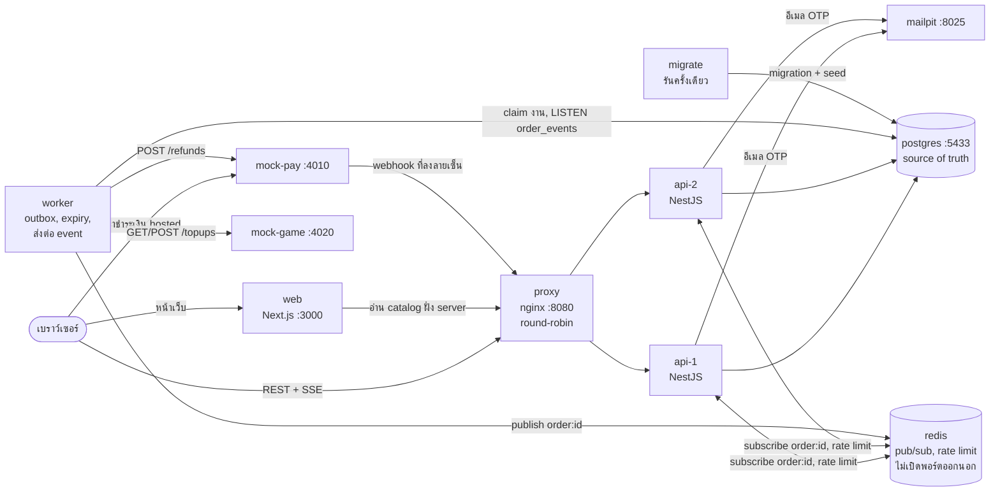

# สถาปัตยกรรม (Architecture)

Postgres คือ source of truth ทุกการเปลี่ยนสถานะ แถว `order_events` ของมัน และงานต่อเนื่อง
(outbox) จะ commit ใน transaction เดียวกัน Redis ทำหน้าที่แค่ส่งสัญญาณ (pub/sub ปลุก) และนับ
rate limit เท่านั้น ถ้า Redis หายก็ไม่เสียข้อมูล เรื่อง concurrency ตัดสินที่ฐานข้อมูล (conditional
`UPDATE`, unique index, row lock และ advisory lock) ไม่ใช่ใน memory ของ process เพราะ API รันสองตัว

## ภาพรวมระบบ

ลำดับการเริ่มระบบบังคับด้วย `depends_on` ของ compose: postgres → migrate (ต้อง exit 0) → redis,
mock-pay, mock-game → api-1/api-2 → proxy → web โดย api และ worker เชื่อมต่อในชื่อ `inblack_app`
ซึ่งเป็น role ที่ไม่ได้เป็นเจ้าของอะไรเลยและปิด trigger ไม่ได้ มีแค่ `migrate` ที่ใช้ role เจ้าของ (ADR 0001)

## การชำระเงิน → fulfillment → สถานะแบบสด

webhook จะไปตกที่ replica ใดก็ได้ที่ nginx เลือก แต่ stream ที่อยู่บนอีก replica ก็ยังเห็น
เพราะสัญญาณมาจาก `NOTIFY` ของ Postgres (ยิงตอน commit โดย trigger สำหรับผู้เขียนทุกราย)
ไม่ใช่มาจาก replica ที่รับ request นั้น ถ้า Redis ล่ม แต่ละ stream จะ poll Postgres ทุก 1 วินาที
ถ้าไม่ล่มจะ poll ทุก 5 วินาทีเป็นตาข่ายกันพลาด (ADR 0003, `apps/api/src/realtime/`)

## การรับมือความล้มเหลว

| จุดที่พัง | ระบบทำอะไร | ทำไมไม่เสียเงินหรือของ | อ้างอิง |
|---|---|---|---|
| API replica หนึ่งตาย | nginx ส่ง traffic ไปอีกตัว transaction ของ request ที่ค้างอยู่จะ rollback รวมถึง idempotency key ด้วย ดังนั้นเมื่อ client retry ก็จะรันใหม่ได้สะอาด SSE stream ที่เปิดอยู่จะเชื่อมต่อใหม่พร้อม `Last-Event-ID` และได้รับเฉพาะ event ที่พลาดไปพอดี | ไม่มีอะไรเขียนค้างครึ่งทาง: key, การจอง, ออเดอร์ และ event อยู่ใน transaction เดียว | 0001, 0003 |
| Worker ตายก่อน POST ไป mock-game | lease ของงาน (`available_at`) หมดอายุ แล้วรอบ poll ถัดไปจะ claim งานนั้นอีกครั้ง | ยังไม่ได้ส่งอะไรออกไป งานเป็นแถวหนึ่งใน Postgres | 0002 |
| Worker ตายระหว่างหรือหลัง POST | attempt ที่เป็น `IN_FLIGHT` จะถูกรับช่วงต่อหลัง lease หมดเท่านั้น ซึ่ง lease ยาวกว่า POST timeout + settle + GET timeout การ claim ใหม่จะ GET reference ก่อน และ POST เฉพาะเมื่อได้ 404 ชัดเจน | หนึ่ง reference `<order_id>:<sku>` ต่อหนึ่งบรรทัด ไม่เปลี่ยนเลย ผล audit: 100 ออเดอร์, kill worker 3 ครั้ง, ไม่มี reference ใดเกิน 1 | 0002 |
| mock-game commit แล้วแต่ timeout (`SUCCESS_BUT_TIMEOUT`) | บันทึก attempt เป็น `UNKNOWN` รอ `FULFILLMENT_SETTLE_MS` (5 s) แล้ว GET เจอ top-up และออเดอร์ complete | timeout แปลว่า "ไม่รู้" และ "ไม่รู้" ไม่มีวันนำไปสู่การ POST | 0002 |
| mock-game ล่ม หรือ GET ไม่ตอบเลย | แต่ละ claim retry พร้อม backoff หลังครบ 5 claim ออเดอร์จะไป `NEEDS_REVIEW` พร้อม dead letter | ไม่มี POST ถ้ายังไม่ยืนยันว่าเป็น 404 ให้คนตัดสินใจ (RUNBOOK) | 0002 |
| mock-game ปฏิเสธทุก POST | หลัง POST 3 ครั้งและ GET ยืนยันรอบสุดท้าย (404): `FAILED`, dead letter และ refund เต็มจำนวนอัตโนมัติใน transaction เดียว พร้อมคืน stock และ voucher | refund อัตโนมัติเฉพาะเมื่อ GET ยืนยันว่าไม่มีอะไรถูกส่ง ถ้าส่งไปบางส่วนจะไป `NEEDS_REVIEW` | 0002, 0004 |
| Webhook ซ้ำ | primary key `webhook_events.event_id`: สำเนาจะรอที่ index แล้วตอบ 200 `duplicate` ถ้าเป็น `event_id` ใหม่สำหรับออเดอร์ที่จ่ายแล้ว จะเขียน `payment.duplicate` และ reconciliation จะรายงาน | การเปลี่ยนสถานะและงานถูกเขียนครั้งเดียว | 0002 |
| Webhook สลับลำดับ (`failed` หลัง `succeeded`) | ไม่มี edge จากสถานะที่จ่ายแล้วไป `PAYMENT_FAILED` จะบันทึกเป็น `payment.failed_ignored` | สถานะไม่มีวันถอยหลัง | 0002, 0004 |
| Webhook ช้า / มาหลัง `EXPIRED` | จอง stock, ลิมิตต่ออีเมล และ voucher ใหม่ภายใต้ lock ชุดเดียวกับตอนสร้างออเดอร์ ถ้าสำเร็จ `EXPIRED → PAID` ไม่เช่นนั้น refund เต็มจำนวนและเป็น `REFUNDED` เมื่อ settle แล้ว ยอดเงินผิด → `NEEDS_REVIEW` | การตรวจลิมิตทั้งสามซ้ำทำให้ invariant 1–4 ยังคงอยู่แม้เงินมาช้า | 0004 |
| ลายเซ็นผิด หรือ clock skew > 300 s | 401 `INVALID_SIGNATURE` ไม่บันทึกอะไรเลย ผู้ให้บริการจะ retry | input ที่ไม่มีลายเซ็นไม่มีวันเปลี่ยนสถานะ | 0002 |
| Redis ล่ม | stream ถอยไปใช้ polling ทุก 1 s worker ยังคง poll outbox ทุกวินาที `/readyz` ตอบ 503 ลิมิตของ track และลิมิต admin login ต่อ IP จะ fail open | Redis ไม่ได้เก็บข้อมูล ส่วน OTP lock และลิมิต admin login ต่ออีเมลอยู่ใน Postgres | 0003, 0005 |
| Postgres ล่ม | API ตอบ 503 problem+json, webhook ได้ 5xx ทำให้ mock-pay retry (8 ครั้ง ประมาณ 4 นาที), worker claim งานไม่ได้ ทุกอย่างกลับมาทำต่อจาก DB เมื่อ Postgres กลับมา | ไม่มีอะไรถูกตอบรับโดยไม่มี commit webhook ที่ค้างนานเกินรอบ retry ของ mock-pay จะไปโผล่ใน reconciliation เป็น `MISSING_IN_SYSTEM` | RUNBOOK |
| refund สองรายการพร้อมกัน (admin สอง session) | row lock ของออเดอร์ทำให้ทำทีละรายการ `planRefund` ตรวจยอดคงเหลือ และมี `CHECK (refunded_satang <= paid_satang)` refund ถูกส่งโดย worker พร้อม `refund_id` ที่ idempotent | Audit s3: ไม่เคยเกินยอดที่จ่าย, DB = ผู้ให้บริการ | 0002 |

`docker kill` คอนเทนเนอร์ใดก็ตามจะไม่ถูกกู้กลับโดย `restart: unless-stopped` มันจะล่มอยู่อย่างนั้นจนกว่าจะสั่ง
`docker compose start <service>` (หรือ `up -d`) เส้นทางกู้คืนทั้งหมดข้างบนจะเริ่มทำงานเมื่อ
process กลับมา

## Data model และ constraint ที่ค้ำ invariant

| ตาราง | หน้าที่ | ตัวป้องกัน |
|---|---|---|
| `products` | catalog, `stock` NULL = ไม่จำกัด | `CHECK (stock IS NULL OR stock >= 0)`; ตัด stock ด้วย `UPDATE ... WHERE stock >= $n` |
| `vouchers`, `voucher_redemptions` | SAVE10 / FLAT20 | `CHECK (used_count <= max_uses)`; partial unique index ใช้ได้หนึ่งครั้งต่ออีเมล |
| `orders` | หนึ่งแถวต่อหนึ่งออเดอร์ เงินทั้งหมดเป็น `bigint` สตางค์ | `CHECK` checksum ของ id; `net = subtotal − discount`; `total = net + fee`; `refunded_satang <= paid_satang` |
| `order_items` | รายการที่ล็อกราคาและ snapshot ชื่อไว้ | `line_total = unit_price × qty`; trigger แบบ append-only |
| `order_status_transitions` | edge ที่อนุญาต (รายการเดียวกับ `packages/domain/src/order-state.ts`, มี drift test ใน `db/src/transitions.spec.ts`) | status trigger ปฏิเสธการเปลี่ยนแบบอื่นทั้งหมด (IB001) |
| `order_events` | timeline แบบ append-only, เป็น id ของ SSE | เขียนโดย status trigger ใน transaction เดียวกัน; `NOTIFY` ตอน insert |
| `idempotency_keys` | เก็บข้อความ response ไว้ replay แบบ byte-identical | primary key `(scope, key)`, เก็บไว้ 24 h |
| `webhook_events` | webhook ทุกตัวที่ได้รับ | primary key `event_id` |
| `outbox`, `dead_letters` | งานที่เขียนพร้อมการเปลี่ยนสถานะ; งานที่ล้มเหลว | claim ด้วย `SKIP LOCKED`, fencing ด้วย `(id, attempts)`; หนึ่ง dead letter ต่อหนึ่งงาน |
| `fulfillment_attempts` | ทุกการ POST ไป mock-game | partial unique index: หนึ่ง `IN_FLIGHT` ต่อออเดอร์, หนึ่ง `SUCCEEDED` ต่อ `(order_id, reference)` |
| `refunds`, `order_hold_releases` | refund; stock/voucher ยังถูกถือไว้หรือคืนแล้ว | unique `provider_event_id`; คืนของที่ถือไว้ได้ครั้งเดียว |
| `customer_otps`, `customer_sessions`, `admin_sessions`, `admin_login_attempts`, `admin_audit_logs` | auth และ audit | เก็บเฉพาะ token และรหัสที่ hash แล้ว |

Migration: `db/migrations/0001`–`0010` ลำดับ lock สำหรับผู้เขียนทุกราย (ADR 0001): idempotency key →
email advisory lock → แถวออเดอร์ → products ตาม SKU → voucher
