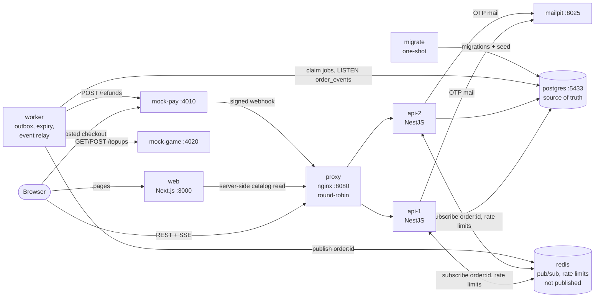
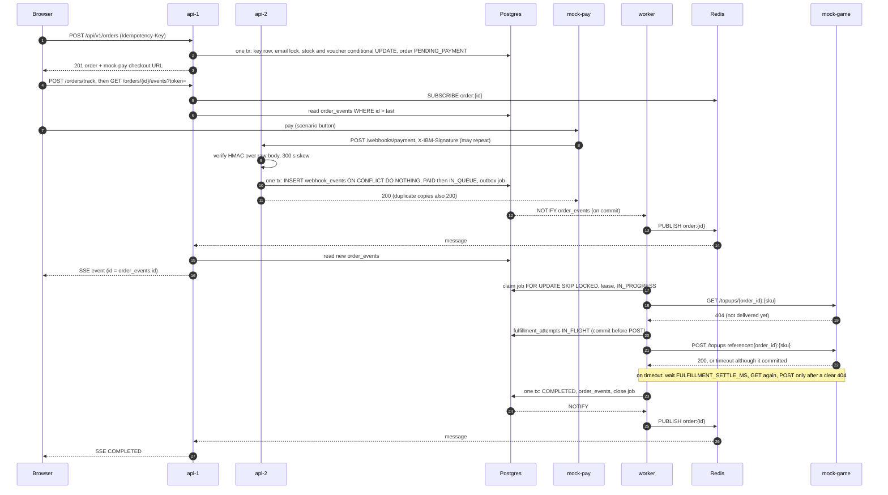

# Architecture

Postgres is the source of truth. Every state change, its `order_events` row and any follow-up job
(outbox) commit in one transaction. Redis only carries hints (pub/sub wake-ups) and rate-limit
counters; losing it loses no data. Concurrency is settled in the database (conditional `UPDATE`,
unique indexes, row and advisory locks), never in process memory, because the API runs twice.

## System

Startup order is enforced by compose `depends_on`: postgres → migrate (must exit 0) → redis,
mock-pay, mock-game → api-1/api-2 → proxy → web. api and worker connect as `inblack_app`, a role
that owns nothing and cannot disable triggers; only `migrate` uses the owner (ADR 0001).

## Payment → fulfillment → live status

The webhook lands on whichever replica nginx picks; the stream on the other replica still sees it
because the signal comes from Postgres `NOTIFY` (fired on commit by a trigger, for every writer),
not from the replica that handled the request. If Redis is down each stream polls Postgres every
second, otherwise every 5 seconds as a safety net (ADR 0003, `apps/api/src/realtime/`).

## Failure handling

| Failure | What happens | Why no money or goods are lost | Ref |
|---|---|---|---|
| An API replica dies | nginx sends traffic to the other one. An in-flight request's transaction rolls back, including its idempotency key, so the client's retry runs again cleanly. Open SSE streams reconnect with `Last-Event-ID` and get exactly the missed events. | Nothing is half-written: key, reservation, order and events are one transaction. | 0001, 0003 |
| Worker dies before POSTing to mock-game | The job's lease (`available_at`) expires and the next poll claims it again. | Nothing was sent; the job is a row in Postgres. | 0002 |
| Worker dies during or after the POST | The `IN_FLIGHT` attempt is taken over only after the lease, which is longer than POST timeout + settle + GET timeout. The new claim GETs the reference first and only POSTs after a clear 404. | One reference `<order_id>:<sku>` per line, never changed; audit: 100 orders, 3 worker kills, no reference above 1. | 0002 |
| mock-game commits but times out (`SUCCESS_BUT_TIMEOUT`) | Attempt recorded `UNKNOWN`; wait `FULFILLMENT_SETTLE_MS` (5 s), then GET finds the top-up and the order completes. | A timeout means "unknown", and unknown never leads to a POST. | 0002 |
| mock-game down or GET never answers | Each claim retries with backoff; after 5 claims the order goes to `NEEDS_REVIEW` with a dead letter. | No POST without a confirmed 404. A person decides (RUNBOOK). | 0002 |
| mock-game refuses every POST | After 3 POSTs and a final confirming GET (404): `FAILED`, dead letter and automatic full refund in one transaction; stock and voucher are returned. | The refund is only automatic when GET confirmed nothing was delivered. Partial delivery goes to `NEEDS_REVIEW`. | 0002, 0004 |
| Webhook duplicated | `webhook_events.event_id` primary key: copies block on the index, then answer 200 `duplicate`. A new `event_id` for an already paid order writes `payment.duplicate` and reconciliation reports it. | The status change and job are written once. | 0002 |
| Webhook out of order (`failed` after `succeeded`) | No edge from a paid status to `PAYMENT_FAILED`; recorded as `payment.failed_ignored`. | Status never moves backwards. | 0002, 0004 |
| Webhook slow / after `EXPIRED` | Re-acquires stock, per-email limit and voucher under the same locks as order creation; on success `EXPIRED → PAID`, otherwise a full refund and `REFUNDED` once settled. Wrong amount → `NEEDS_REVIEW`. | Re-checking all three limits keeps invariants 1–4 intact for late money. | 0004 |
| Bad signature or clock skew > 300 s | 401 `INVALID_SIGNATURE`, nothing stored; the provider retries. | Unsigned input never changes state. | 0002 |
| Redis down | Streams fall back to 1 s polling; the worker still polls the outbox every second; `/readyz` answers 503; track and per-IP admin login limits fail open. | Redis holds no data. OTP lock and per-email admin login limit are in Postgres. | 0003, 0005 |
| Postgres down | API answers 503 problem+json; webhooks get 5xx so mock-pay retries (8 times, about 4 minutes); the worker cannot claim jobs. Everything resumes from the DB when it is back. | Nothing is acknowledged without a commit. A webhook that outlives mock-pay's retries shows up in reconciliation as `MISSING_IN_SYSTEM`. | RUNBOOK |
| Two refunds at once (two admin sessions) | The order row lock serialises them; `planRefund` checks the remainder; `CHECK (refunded_satang <= paid_satang)`. Refunds are sent by the worker with an idempotent `refund_id`. | Audit s3: never above the paid amount, DB = provider. | 0002 |

`docker kill` of any container is not undone by `restart: unless-stopped`; it stays down until
`docker compose start <service>` (or `up -d`). All the recovery paths above start when the
process comes back.

## Data model and the constraints that hold the invariants

| Table | Purpose | Guard |
|---|---|---|
| `products` | catalog, `stock` NULL = unlimited | `CHECK (stock IS NULL OR stock >= 0)`; stock taken with `UPDATE ... WHERE stock >= $n` |
| `vouchers`, `voucher_redemptions` | SAVE10 / FLAT20 | `CHECK (used_count <= max_uses)`; partial unique index one redemption per email |
| `orders` | one row per order, all money in `bigint` satang | id checksum `CHECK`; `net = subtotal − discount`; `total = net + fee`; `refunded_satang <= paid_satang` |
| `order_items` | locked lines with price and name snapshot | `line_total = unit_price × qty`; append-only trigger |
| `order_status_transitions` | allowed edges (same list as `packages/domain/src/order-state.ts`, drift test in `db/src/transitions.spec.ts`) | status trigger rejects any other move (IB001) |
| `order_events` | append-only timeline, SSE ids | written by the status trigger in the same transaction; `NOTIFY` on insert |
| `idempotency_keys` | stored response text for byte-identical replay | primary key `(scope, key)`, kept 24 h |
| `webhook_events` | every received webhook | primary key `event_id` |
| `outbox`, `dead_letters` | jobs written with the state change; failed jobs | claim with `SKIP LOCKED`, fencing by `(id, attempts)`; one dead letter per job |
| `fulfillment_attempts` | every POST to mock-game | partial unique indexes: one `IN_FLIGHT` per order, one `SUCCEEDED` per `(order_id, reference)` |
| `refunds`, `order_hold_releases` | refunds; whether stock/voucher are held or released | unique `provider_event_id`; holds released only once |
| `customer_otps`, `customer_sessions`, `admin_sessions`, `admin_login_attempts`, `admin_audit_logs` | auth and audit | hashed tokens and codes only |

Migrations: `db/migrations/0001`–`0010`. Lock order for every writer (ADR 0001): idempotency key →
email advisory lock → order row → products by SKU → voucher.
